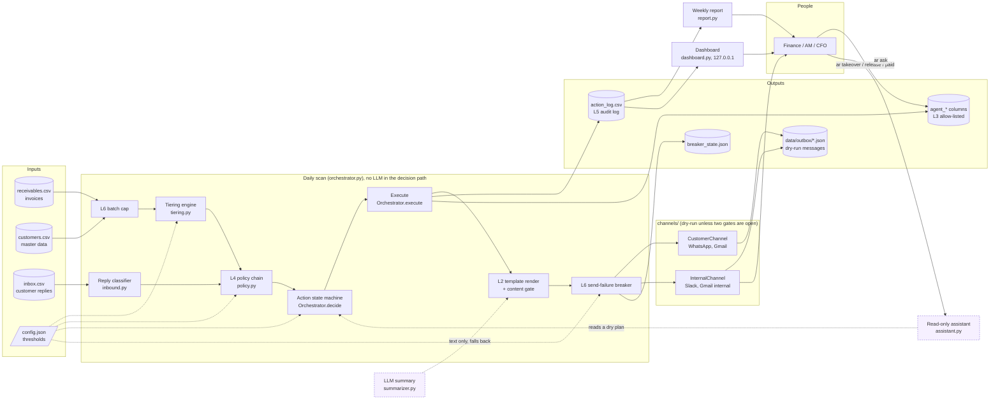
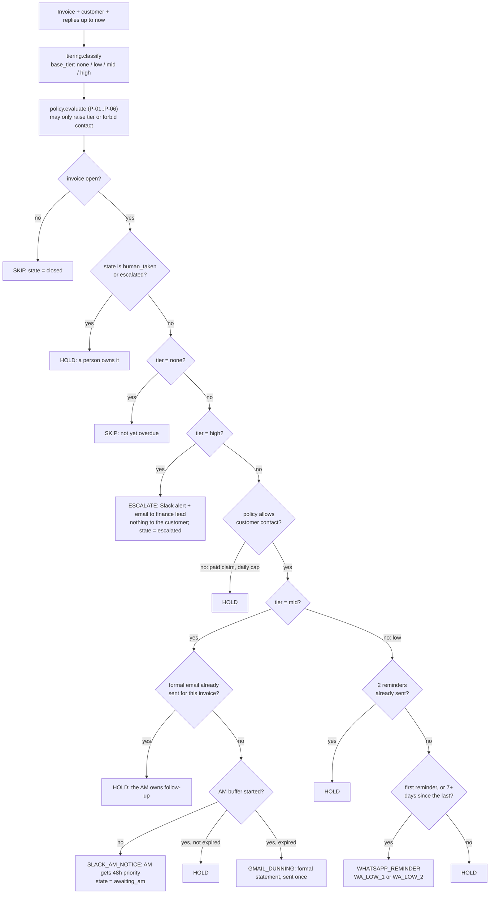
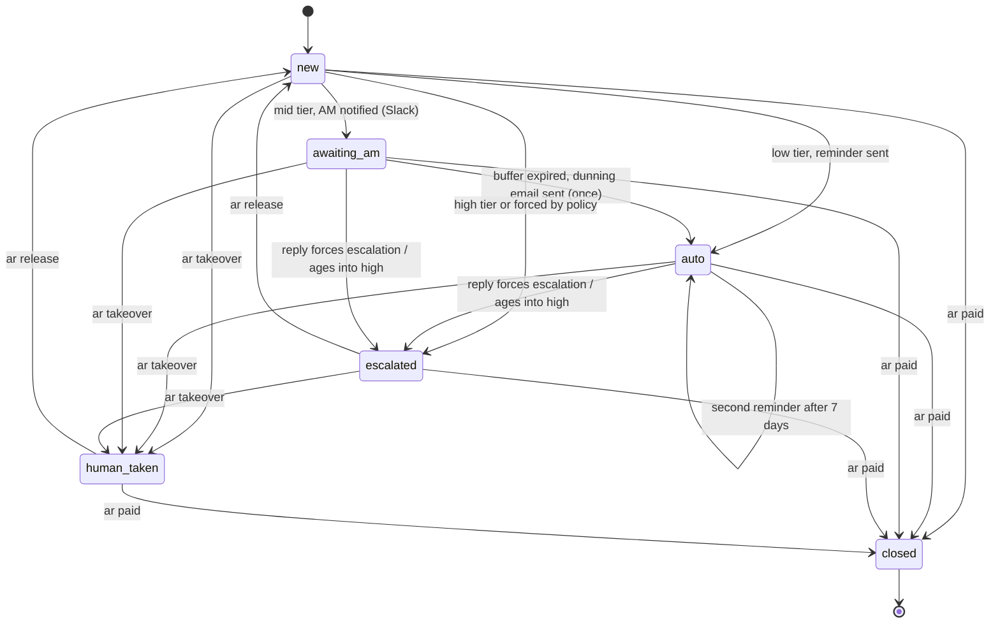

# Architecture

This document describes how the AR Collections Agent is built: what each part does, the data it reads and writes,
the interfaces between parts, where the guardrails sit, and what would need to change to run it in production.
Product intent (problem, users, success metrics) is in [`PRD.md`](PRD.md); this document is about the code.

File and line references are to `src/ar_agent/` unless stated otherwise.

## 1. System overview

The system is a **deterministic decision pipeline with two optional, read-only LLM features on the side**.
Every decision that affects a customer (tier, whether to contact, what to send, when to stop) is made by plain
Python reading `config.json` thresholds. The LLM only writes text for people: a summary inside internal alerts, and
answers to finance staff's questions. Neither LLM feature can send, write or decide anything.

### 1.1 One invoice through one scan

`Orchestrator.decide()` (`orchestrator.py`) turns facts into exactly one action. The order of the checks is the
design: terminal states first, then high risk, then the policy gate, and only then the per-tier cadence.

### 1.2 Agent state machine

Persisted per invoice in the `agent_state` column. Only `execute()`, `takeover()`, `release()` and `mark_paid()`
change it.

A mid-tier invoice in `auto` with a recorded buffer has already had its one formal email, so the agent holds;
it leaves that state when it is paid, taken over, or ages into high risk and escalates.

`escalated` and `human_taken` are sticky: the agent holds on every later scan until a person runs `ar release` or
`ar paid`. There is no path from `escalated` back to automation that does not go through a person.

## 2. Components

| Module | Responsibility | LLM? | Writes |
|---|---|---|---|
| `config.py` | Loads `config.json`; dotted lookups; the two-gate `channel_is_live()` | no | nothing |
| `models.py` | Dataclasses and enums: `Invoice`, `Customer`, `Decision`, `Message`, `SendResult`, `Tier`, `AgentState`, `ActionType`, `Actor` | no | nothing |
| `tiering.py` | Pure function `classify(invoice, customer, cfg, today) -> TierResult`. Checks high, then mid, then low, so mistakes land on the strict side | no | nothing |
| `inbound.py` | `classify_reply(text)`: keyword/regex intent classifier with full-width and spacing normalisation; highest-risk category wins | no | nothing |
| `policy.py` | L4 rule chain P-01..P-06. Each rule can only raise the tier or forbid customer contact (`PolicyOutcome.escalate_to` never lowers) | no | nothing |
| `orchestrator.py` | The scan: reads inbox, batches, decides, executes, writes back state, logs. Also `takeover`, `release`, `mark_paid` | calls `summarizer` for alert text only | store, inbox, audit log, outbox (via channels) |
| `templates.py` | L2: the only way to produce message text. `render(template_id, variables)` has no free-text parameter; customer templates pass a banned-phrase gate | no | nothing |
| `channels/` | `CustomerChannel` vs `InternalChannel` base classes; dry-run outbox writer; WhatsApp (Meta template messages only), Gmail (SMTP), Slack (webhook or bot token) | no | outbox / external APIs |
| `store/` | L3: `ReceivablesStore` with a field allow-list; `CsvStore` (default) and `GoogleSheetsStore` | no | invoice table (agent columns only) |
| `breaker.py` | L6: batch cap per scan; N consecutive send failures trip a channel; daily customer send counter for P-05; persisted, manual reset only | no | `breaker_state.json` |
| `audit.py` | L5: append-only CSV log; `actor` (agent / human / system) is the first-class field | no | `action_log.csv` |
| `summarizer.py` | LLM use 1: summarises an invoice's contact history for internal high-risk alerts; output checked, falls back to the raw list | **yes** | nothing |
| `assistant.py` | LLM use 2: read-only Q&A for finance via function calling over four read-only tools | **yes** | nothing |
| `report.py` | Weekly CFO report (Markdown + HTML): exposure, tiers, coverage, first-touch time, unresponsive AMs, guardrail metrics | no | `reports/` |
| `dashboard.py` | Local HTTP server on `127.0.0.1`; `/api/state?date=` builds state from a dry plan | no | nothing |
| `verify.py` | `ar verify`: 24 live checks that each deliberately cross a boundary and assert it was stopped | no | scratch copies only (restores what it touches) |
| `seed.py` / `demo.py` / `cli.py` | Demo data designed to hit every branch; the 13-scene guided demo; argparse CLI | no | `data/` |

## 3. Data model

All state is in `data/` as CSV/JSON so it can be opened in Excel and diffed. In production the store would be a
database or the ERP (see section 9).

**`receivables.csv`**: one row per invoice. Columns are split by ownership (`store/csv_store.py`, `store/base.py`):

| Owner | Columns | Agent may write? |
|---|---|---|
| Finance system (business master data) | `invoice_id, customer_id, amount, issue_date, due_date, status (open/paid/disputed), paid_date` | **No**: `PermissionDeniedError`. `invoice_id` is the lookup key, so it cannot even be passed as a field |
| Agent | `agent_tier, agent_stage (reminders sent), agent_state, agent_last_action_at, agent_buffer_until, agent_owner, agent_note` | Yes, via `update_agent_fields()` only |

**`customers.csv`**: `customer_id, name, contact_name, whatsapp, email, account_manager, am_slack_id, is_vip,
prior_late_count, avg_days_to_pay, credit_terms_days`. Read-only to the agent.

**`inbox.csv`**: customer replies: `reply_id, invoice_id, customer_id, received_at, channel, text, processed,
intent`. The scan tags `intent` and `processed`; intents used for decisions are recomputed from `text` every scan,
using only replies with `received_at <= now`, so `--date` replays never see the future.

**`action_log.csv`** (`audit.py`): `timestamp, run_id, actor, invoice_id, customer_id, customer_name, tier,
base_tier, action, channel, recipient, template_id, mode (live/dry_run/blocked), ok, reasons, policy_hits,
content_preview`. `base_tier` vs `tier` shows exactly what the policy layer changed.

**`breaker_state.json`**: `consecutive_failures{channel}`, `tripped{channel: when}`, `sends_by_date{date: n}`
(customer-facing sends only).

**`outbox/*.json`**: one file per dry-run message: `channel, audience, to, subject, body, template_id,
invoice_id, customer_id, sent_at, mode`.

**In memory**: `Decision` (invoice, customer, `tier`, `base_tier`, `action`, `reasons`, `policy_hits`,
`agent_may_contact_customer`, `detail`) and `ScanReport` (counts, sends, escalations, `halted`, `blocked`).

## 4. Interfaces

### 4.1 Internal interfaces (the "tools" the pipeline uses)

| Interface | Signature | Contract |
|---|---|---|
| Template renderer | `templates.render(template_id: str, variables: dict) -> (subject, body)` | No free-text input. Unknown id: `KeyError`. Missing variable: `KeyError`. Customer template with banned wording (case-insensitive): `TemplateViolation`. The orchestrator catches both, logs `mode=blocked`, and continues the scan |
| Channel | `Channel.send(msg: Message) -> SendResult` | Never raises. Audience mismatch: `mode=blocked`. Live errors become `ok=False`. Dry-run writes to the outbox |
| WhatsApp live payload | `whatsapp.build_payload(msg) -> dict` | Always `type=template` with a mapped, Meta-approved template; unmapped template or missing variable raises (fail closed). The rendered free-text body is never sent |
| Store | `update_agent_fields(invoice_id, **fields)` | Raises `PermissionDeniedError` if any field is outside the allow-list; checked before any write, so a mixed write has no effect |
| Breaker | `batch(invoices)`, `is_tripped(channel)`, `record_send(channel, ok, date, customer_facing)`, `reset(channel)` | Trips after `consecutive_send_failures_to_pause` failures; no automatic recovery |
| Policy | `policy.evaluate(PolicyContext, cfg) -> PolicyOutcome` | Monotonic: rules only tighten. New rules subclass `PolicyRule` and are added to `DEFAULT_RULES` |
| LLM transport | `Transport = Callable[[url, headers, payload, timeout], dict]` | Injected into `Summarizer` and `Assistant`; tests pass fakes. Default is a stdlib `urllib` POST (Ollama `/api/chat` or Anthropic Messages API) |

### 4.2 LLM tool interface (`assistant.py`)

The assistant's model can call four tools. All four read a **dry plan** (`daily_scan(dry_plan=True)`), the audit log
and the inbox; none writes. Arguments are validated against the JSON Schema below before anything runs
(`validate_args`): unknown tool, unknown argument, wrong type, out of range or bad invoice-ID format return an
error result to the model instead of executing.

| Tool | Parameters | Returns |
|---|---|---|
| `get_overview` | none | open/overdue counts and amounts, per-tier count and amount, top 5 customers by overdue amount |
| `list_invoices` | `tier` (enum), `min_days_overdue` (0..3650), `customer` (substring), `limit` (1..30) | rows with amount, days overdue, tier, next action, VIP flag |
| `get_invoice` | `invoice_id` (`^INV-\d{1,8}$`) | detail incl. `base_tier`, `reasons`, `policy_hits`, `agent_may_contact_customer`, state, owner |
| `get_case_history` | `invoice_id`, `limit` (1..20) | recent audit actions and customer replies with detected intent |

The loop is bounded by `llm.max_tool_calls` (6). The final answer must pass `check_answer`: every number with two or
more digits must appear in the question or a successful tool result, otherwise the answer is withheld and the raw
tool results are shown.

## 5. Safety, guardrails and human-in-the-loop

The design follows the seven-layer model in PRD §5. The important property is that the layers that protect
customers (L2, L3, L4, L6) are code, not prompt.

| Layer | Where | What it guarantees | Tested in |
|---|---|---|---|
| L1 System prompt | `summarizer.SYSTEM_PROMPT`, `assistant.SYSTEM_PROMPT` | Tells the model customer text is data, not instructions. **Not relied on**: every other layer assumes it fails | `test_summarizer`, `test_end_to_end` |
| L2 Tool design | `templates.render`, `FORBIDDEN_PATTERNS`, WhatsApp template mapping | Only reviewed templates can be sent; no way to pass free text; promises (instalments, discounts, extensions, write-offs) and pressure wording blocked in customer text | `TestTemplates`, `TestChannelFailures`, `test_whatsapp` |
| L3 Agent IAM | `store/base.py` allow-list | The agent cannot change amounts, due dates or payment status | `TestStorePermissions` |
| L4 Runtime policy | `policy.py` P-01..P-06 | Terms-change and dispute replies force high risk + no contact; amount ceiling; VIPs always human; daily customer send cap; "already paid" pauses | `TestPolicy`, `TestContactRules`, `TestDailyCap` |
| L5 Observability | `audit.py` | Every action has actor, rule hits, base vs final tier, mode | `TestHumanInTheLoop.test_audit_log_records_who_acted` |
| L6 Circuit breakers | `breaker.py` | Batch cap; dead channel trips after 5 failures and stays tripped until a person resets it | `TestBreaker`, `TestChannelFailures`, `TestBatchCap` |
| L7 Compliance | templates wording, dry-run default, two-gate live switch | No pressure language; nothing is sent by accident. **Role-based access to customer data is not implemented** (see section 9) | `TestLiveGate` |

Additional structural guarantees:

- **Customer vs internal channels are different types.** An internal template on a customer channel is refused
  before any network call (`Channel.send`).
- **High risk is notify-only.** `ESCALATE` sends a Slack alert and an email to the finance lead and nothing else.
  The headline invariant, *zero customer messages for high-risk invoices*, is asserted by `verify` on a real scan and
  by `test_end_to_end` after every scan of the demo week.
- **The LLM cannot change a decision.** `test_end_to_end` runs the same week with the LLM off, mocked, hallucinating
  and timing out, and asserts the decisions are identical.

### Human-in-the-loop points

| Point | Trigger | What the person gets | What the agent does |
|---|---|---|---|
| Mid-tier buffer | Invoice is mid tier | Slack notice with 48 hours' priority and the exact `ar takeover` command | Waits; sends a formal statement only if nobody acts; the AM is listed in the weekly report as unresponsive |
| High-risk escalation | Tier high, or forced by P-01..P-04 | Slack alert + email: reasons, rules hit, contact-history summary, "the system has sent nothing" | Stops all customer contact for good (`escalated` is sticky) |
| Paid claim | Customer says it paid (P-06) | (visible in dashboard / log) | Holds until finance runs `ar paid` |
| Takeover / release | `ar takeover INV --by NAME`, `ar release` | Full control | Holds on every scan until released |
| Breaker trip / daily cap | 5 send failures on a channel, or P-05 cap | Slack breaker alert with the reset command | Stops that channel (or all customer sends) until `ar reset-breaker` |
| Recording payment | `ar paid` | Only a person can mark paid; the agent's store adapter cannot | Closes the invoice |

Takeover is an explicit command on purpose. Slack is write-only for the agent: chat messages are never read as
authorisation (`channels/slack.py`).

## 6. Observability and logging

- **Audit log** (`action_log.csv`): one row per decision and per send, including holds and skips, with `run_id`
  to group a scan. `ar log -v` filters by invoice and actor; the dashboard shows it; the weekly report derives
  coverage, first-touch time, unresponsive AMs and the guardrail metrics (`vip_auto_contacted`,
  `wrong_escalations`, target 0) from it.
- **Outbox**: the exact text of every dry-run message, for review before going live (`ar outbox`).
- **Scan summary** on stdout: scanned, actions, sends ok/total, escalations, deferred, halts, content-gate blocks.
- **LLM fallbacks are visible**: when a summary is rejected or the model fails, the alert says why
  (`"AI summary failed the check, fell back: ..."`). The assistant returns `source` = `llm` / `withheld` / `error`
  with a note.
- **`ar verify`**: 24 executable checks, suitable for a pre-deploy gate.

Not yet present: structured (JSON) logs, metrics export, tracing, log shipping, alerting on scan failure. See
section 9.

## 7. Failure modes

| Failure | Handling | Residual risk |
|---|---|---|
| LLM down, slow, wrong auth, bad JSON | `summarize()` catches everything and falls back to the raw fact list; scan continues; decisions unchanged | None for decisions; alerts are less concise |
| LLM invents an amount or date | Number check rejects the summary/answer; raw facts or raw tool results shown | Numbers with one digit and non-numeric fabrications are not caught by this check |
| Prompt injection in a customer reply | Replies are classified by keywords, never by a model; in LLM prompts they are wrapped in `<facts>` as data; assistant has no write tools | The summary text could be steered, but it only reaches internal readers and sits above the raw records |
| Model asks for a non-existent or write tool | `validate_args` refuses; error returned to the model | None |
| Customer channel down / credentials revoked | `Channel.send` returns `ok=False`; state not advanced, so the reminder is retried next scan; after 5 consecutive failures the channel trips and a breaker alert is sent | If Slack is the failing channel, the breaker alert also goes through Slack |
| Content gate hits a variable (e.g. a contact name) | That one message is blocked and logged `mode=blocked`; invoice state unchanged; scan continues; not counted as a channel failure | Re-blocked every scan until the data is fixed; visible in scan output and log |
| Logic bug that would contact everyone | P-05 caps customer sends per day (50) and halts with an alert; batch cap 200 per scan | Up to the cap could still go out |
| Mid-tier AM notice fails | Buffer does not start; notice is retried next scan | |
| Escalation alerts fail to deliver | Invoice is still marked `escalated`, so the customer is not contacted (fails safe for the customer) | Finance may not hear about it except via the log, dashboard and weekly report |
| Missing customer master data | Invoice skipped and logged as `system` | |
| More than 200 invoices | Rest deferred to the next scan and logged | Large books need more frequent scans |
| Crash between send and state write-back | Next scan re-sends (at-least-once) | Possible duplicate reminder; needs an idempotency key in production |
| Two scans at once | Not handled: no lock on the CSV store | Duplicate sends; needs a lock or a DB transaction |
| Reply that matches no keyword | Treated as `unknown`; no effect on routing | A new phrasing of "can we pay later" is missed until the keyword list is updated (see interview notes Q4) |

## 8. Configuration and deployment today

- Python 3.10+ standard library only for the core; `google-api-python-client` only for the Sheets adapter.
- All thresholds in `config.json`; LLM provider via `AR_LLM_PROVIDER` / `AR_LLM_MODEL`; credentials in `.env`.
- Live sending needs both `channels.<name>.live = true` and `AR_LIVE=1`.
- Scheduling is external (cron or Windows Task Scheduler running `python ar.py scan`).
- Tests: `pytest` (or `python -m unittest discover -s tests`), offline, no API key; `tests/conftest.py` blocks the
  network.

## 9. Production-hardening next steps

**Scaling and data**

- Replace the CSV store with a database (Postgres): row-level updates in a transaction instead of rewriting the
  file, a column-level grant or view enforcing the L3 allow-list in the database rather than only in code, and an
  advisory lock (or `SELECT ... FOR UPDATE SKIP LOCKED`) so two scans cannot process the same invoice.
- Make sends idempotent: derive a key from `(invoice_id, template_id, stage)` and store it before sending, so a crash
  between send and write-back cannot produce a duplicate reminder. Use the provider's idempotency features where
  available.
- Move from one batch scan to a queue: a scheduler enqueues due invoices, workers process them, and per-channel rate
  limits replace the single batch cap. Inbound replies should arrive by webhook (WhatsApp, Gmail push) instead of a
  CSV file.
- Use timezone-aware datetimes throughout (today they are naive local time).

**Auth and access (L7)**

- The CLI and dashboard have no authentication; `takeover`, `release` and `paid` trust the `--by` argument. Put them
  behind SSO with roles (account manager, finance, CFO, admin), record the authenticated identity in the audit log,
  and require finance role for `paid` and `reset-breaker`.
- Restrict who can see customer financial data; the dashboard currently binds to `127.0.0.1` only, which is its sole
  protection.
- Secrets in a secret manager, not `.env`; separate service accounts per channel with least privilege.

**Audit trail**

- Make the audit log tamper-evident: append-only table with no update/delete grant, or a hash chain over rows,
  shipped to write-once storage. Log configuration changes (`config.json` is effectively policy) with who changed
  what and when, and version templates so each sent message references the exact reviewed template version.
- Store the rendered message (or its hash) for each live send, alongside the provider message ID.

**Compliance**

- Contact-time windows and per-customer frequency limits as additional L4 rules (debt-collection rules in many
  jurisdictions restrict both). Opt-out handling ("stop contacting me") as a forced-escalation intent.
- Data retention and deletion for customer messages; PII minimisation in what goes to the LLM (an on-premise model
  via Ollama is already supported for this reason).
- Legal/compliance sign-off workflow for adding or changing templates and keyword lists, recorded in version control.

**Reliability and operations**

- Structured logs and metrics (scan duration, sends by channel and result, escalations, fallbacks, breaker trips)
  with alerts on: a scan not running, a breaker trip, escalation alerts failing to deliver, guardrail metrics above 0.
- A second alert path for breaker trips that does not depend on the failing channel (e.g. email or pager when Slack
  is down).
- Route `unknown` replies to a human queue instead of ignoring them, and track the rate as a signal that the keyword
  list needs updating. An LLM classifier could *propose* keywords for review but should not make the routing
  decision.
- Run `pytest` and `ar verify` in CI on every change; `ar verify` again as a pre-deploy gate against production
  configuration.
